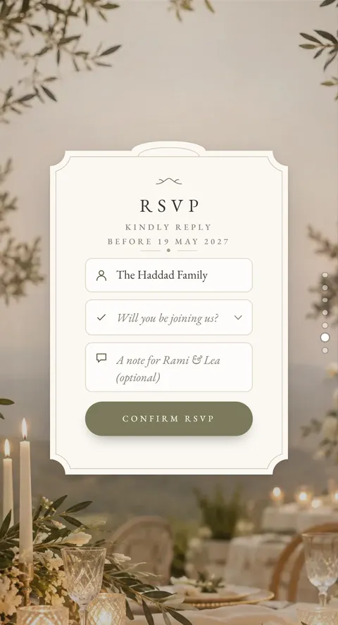
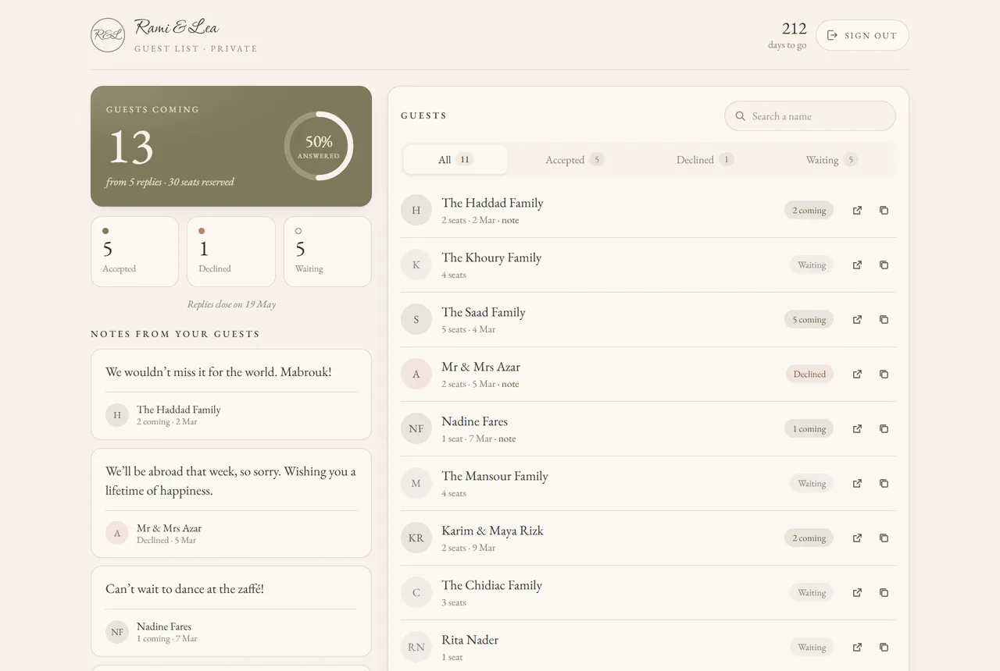

# Rami & Lea — Digital Wedding Invitation

A wedding invitation that opens like a real envelope, in English or Arabic, with RSVP replies saved in a database and a private dashboard for the couple. It is also the first template of an invitations platform: a new invitation is a new data file, not new code.

**Live demo**

- Invitation: https://rami-lea.vercel.app/
- A guest's personal link: https://rami-lea.vercel.app/i/rami-lea/haddad-7x2k
- Couple's dashboard: https://rami-lea.vercel.app/dashboard (password on request)

> A demo with sample names. Best viewed on a phone.

| Envelope | Opening | Letter | Countdown | Celebration |
| --- | --- | --- | --- | --- |
|  |  |  |  |  |

| Good to know | Reply | Thank you | Arabic | Arabic letter |
| --- | --- | --- | --- | --- |
|  |  |  |  |  |

**The couple's dashboard**



## Features

**For guests**

- An envelope tied with a satin ribbon that unties and opens, with a skip button.
- Their own name, language (English or Arabic, right to left) and only the events they are invited to.
- The couple's photo, a letter from both families, a live countdown and the events with a map link.
- An RSVP form: coming or not, how many people (1 to 7), and a note for the couple. They can change their reply later.
- Practical notes, gift details that copy with one tap, and a QR code to the shared photo album.

**Two kinds of link**

- A personal link per guest (`/i/rami-lea/haddad-7x2k`): their name is on the envelope and the form already knows who is replying.
- A shared link for a group chat (the home page): every event is listed and guests write their own name.

**For the couple**

- A private dashboard behind a password, shown as a card over a blurred photo: guests coming, accepted, declined, waiting, the notes guests left, and each guest's link to copy.
- A sign-out button, so the dashboard does not stay open on a shared phone or laptop.

**For each new invitation**

- A new data file in `src/data/invitations/` instead of new code.
- Optional sections, such as gifts and the album, disappear when left out.
- A WhatsApp link preview and a browser icon drawn from the data (names, date, monogram).
- Guest pages and the dashboard ask search engines not to list them.

## How it works

- Next.js pre-builds one page per guest at `/i/[slug]/[token]`. The unguessable token in the link decides whose invitation is shown, so guests need no sign-in.
- Everything about an invitation (names, dates, photos, events and guests) lives in one data file. The components only read it.
- Replies are saved in Supabase by a Server Action, which checks everything again on the server. The database key never reaches the browser.
- The envelope is a photo cut into four flaps with CSS, so it opens in 3D. Every animation respects the phone's reduced-motion setting.

## Security

- **Server-side checks**: the answer, the number of people (1 to the limit in the data), the note's length and the guest's name. A personal link always saves the name from the data, never one sent by the browser.
- **Rate limits** per visitor, counted in the database: 20 new shared-link replies per hour, 10 dashboard password attempts per 15 minutes. The visitor's IP address is stored only as a hash.
- **A honeypot field** in the RSVP form: invisible to people, filled by bots, which are then ignored.
- **Dashboard sign-in**: the password is compared in constant time; the cookie holds a hash, not the password, cannot be read by the page's JavaScript, and is only sent to `/dashboard`. Changing the password signs everyone out. Nothing about the guests is sent before the password is right.
- **Security headers**: no framing by other sites, no MIME sniffing, no private link sent to other sites (such as Google Maps), and no camera, microphone or location.

## Speed

Guests open the invitation from WhatsApp, often on mobile data.

- On ordinary 4G, on a mid-range Android: first content in about 0.8 s, largest content in about 0.9 s.
- The envelope and its ribbon are asked for first; the decorations of the next pages wait until the envelope has arrived.
- Photos are resized for each screen, lazy below the first page, and kept on the phone for a day when a guest reopens the link.
- Fonts are self-hosted with `next/font`.

## Tests

88 tests run on every pull request (GitHub Actions), and a pull request cannot be merged if one fails.

- **Unit tests** (Vitest, 51): the RSVP Server Action with a fake database, the dashboard password and cookie, the rate limits, and the invitation data itself (unique tokens, events that exist, photos that exist, both languages filled in).
- **End-to-end tests** (Playwright, 37): the built site in a real browser on a phone screen, with a fake database. Opening the envelope in both languages, replying, changing a reply, a database that is down, the dashboard sign-in and sign-out, bots, security headers, and that the secret key never reaches the browser.
- **Speed budgets**: the invitation is measured on 4G and on Slow 4G, and a pull request fails if it gets slower or heavier.
- **Security audit** of dependencies on every pull request, and GitHub security alerts by email.

## Tech stack

Next.js 16 (App Router, Cache Components) · React 19 · TypeScript · CSS Modules · Supabase · Vitest · Playwright · GitHub Actions · Vercel

## Getting started

Requires Node.js 22.

```bash
npm install
npm run dev   # http://localhost:3001
```

Open `http://localhost:3001/` (the shared link) or a guest page such as `http://localhost:3001/i/rami-lea/haddad-7x2k`.

Replies and the dashboard need a `.env.local` file:

```bash
SUPABASE_URL=...
SUPABASE_SECRET_KEY=...
DASHBOARD_PASSWORD=...
```

The rate limits need `supabase/rate_limits.sql`, run once in the Supabase SQL Editor. Without it the site still works, without the limits.

| Script | What it does |
| --- | --- |
| `npm run dev` | Development server on port 3001 |
| `npm run build` | Production build |
| `npm run lint` | ESLint |
| `npm test` | Unit tests (Vitest) |
| `npm run test:e2e` | Builds the site and runs the end-to-end tests (Playwright) with a fake database |

## Author

Built by [Maya Chaker](https://maya-chaker-portfolio.vercel.app).
