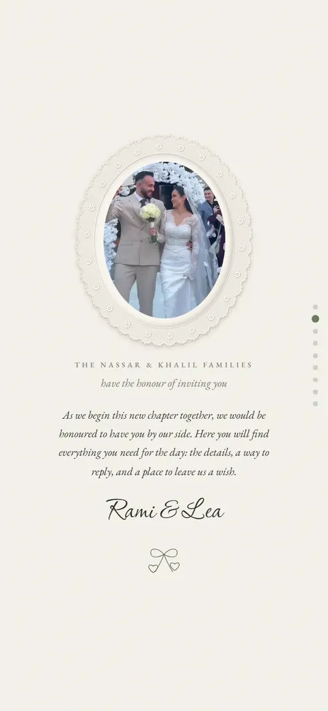
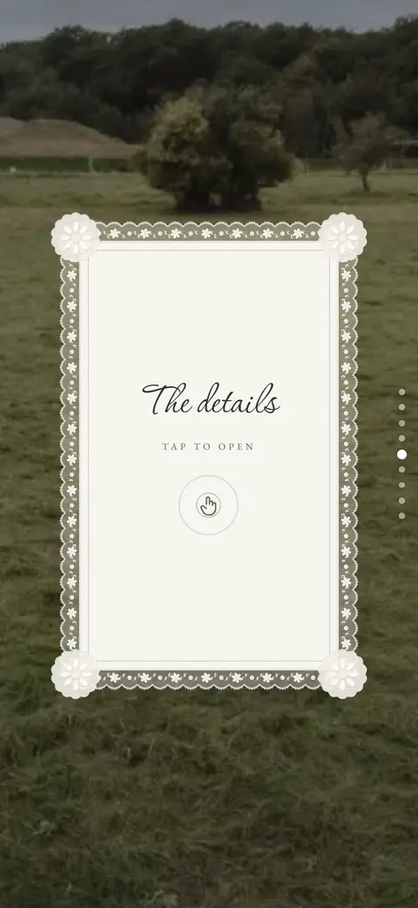
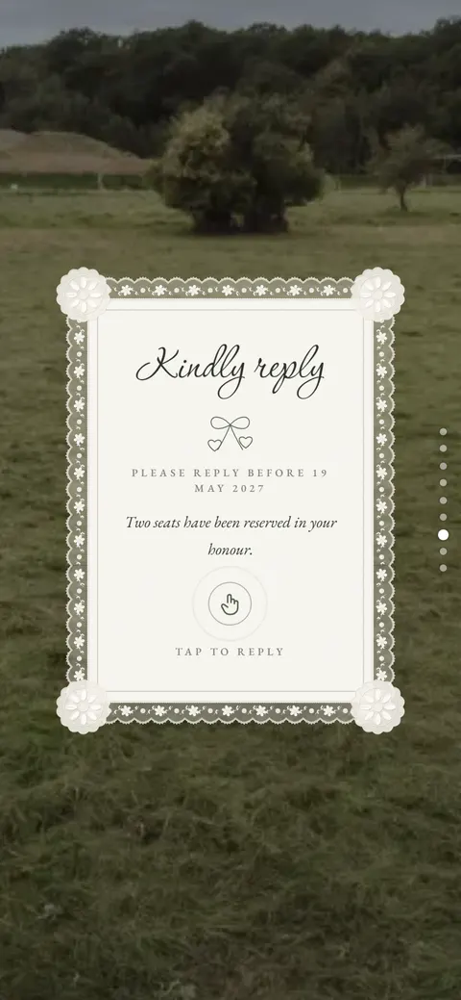

# Rami & Lea — Digital Wedding Invitation

A wedding invitation that opens like a real envelope. Each guest gets a private link that shows their own name, language, seats and the events they are invited to.

**Live demo:** https://rami-lea.vercel.app/i/rami-lea/haddad-7x2k

> This is a demo with sample names, and it is still in progress.

| Envelope | Opening | Letter | Details | Reply |
| --- | --- | --- | --- | --- |
|  |  |  |  |  |

## Features

**For guests**

- A tap-to-open envelope, with a skip button.
- Their own name, language (English or Arabic), seats and events.
- The couple's video, a letter, a live countdown and the event details with a map link.
- A reply form, practical notes, gift details that copy with one tap, and a QR code to the shared photo album.

**For each new invitation**

- A new data file instead of new code.
- Optional sections, such as gifts and the album, disappear when left out.
- A WhatsApp link preview in the guest's language.
- Guest pages ask search engines not to list them.

## How it works

- Next.js pre-builds one page per guest at `/i/[slug]/[token]`. The unguessable token in the link decides which guest's name, language and seats are shown, so guests need no sign-in.
- Everything about an invitation (names, dates, media, events and guests) lives in one file in `src/data/invitations/`. The components only read it.
- The envelope and lace are drawn on canvas, and the animations respect the reduced-motion setting.

## Tech stack

Next.js (App Router) · React · TypeScript · CSS Modules · Canvas · `qrcode` · Vercel

## Getting started

Requires Node.js 20 or newer.

```bash
npm install
npm run dev   # http://localhost:3001
```

Open a guest page such as `http://localhost:3001/i/rami-lea/haddad-7x2k`.

| Script | What it does |
| --- | --- |
| `npm run dev` | Development server on port 3001 |
| `npm run build` | Production build |
| `npm run lint` | ESLint |

## What's next

- Save replies to a database, so the hosts can follow them in a dashboard. For now a reply is kept in the guest's browser.

## Author

Built by [Maya Chaker](https://maya-chaker-portfolio.vercel.app).
